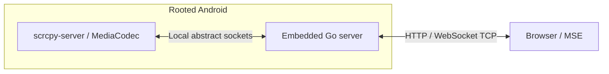

# WebScrcpy

**Control your rooted Android device directly from a browser over pure TCP.** Install one APK on the device, grant root, start the service and open its address. No PC, ADB, WebRTC, UDP or relay server is required for screen streaming.

[中文使用说明](doc/android-apk.md)

## Quick start

1. Download the Android arm64 APK from [Releases](https://github.com/Cedar17/WebScrcpy/releases) or the Build APK Actions artifact for development builds.
2. Install on a rooted Android 8+ device and grant root.
3. Configure a PIN, start the service and open the displayed HTTP URL (default port 8079) in your browser.
4. Select the local device and start streaming. H.264 is recommended; H.265 and Opus audio depend on browser and device support.

## Architecture



Video, audio and control share the WebSocket endpoint. The APK runs a foreground service with optional boot startup. Touch, keyboard, clipboard and screen controls are retained where supported.

WebScrcpy is an independently maintained fork focused exclusively on rooted Android self-hosting. Desktop capture, NAS/fnOS, Docker and external ADB device management are not supported.

## Build

Use GitHub Actions **Build APK**, or use Go, JDK 17 and Android SDK 34:

```sh
make ci
mkdir -p app/src/main/jniLibs/arm64-v8a
cp dist/webscreen-android-arm64 app/src/main/jniLibs/arm64-v8a/libwebscreen.so
./gradlew assembleDebug
```

The pure TCP 1.3.0 baseline was user-tested; the 1.4.0 cleanup requires a new build and device regression test. See [CHANGELOG](CHANGELOG.md).

## Security and compatibility

HTTP/WS is unencrypted. Configure a PIN and use a trusted private network or secure VPN; never expose this root service directly to the Internet. Some inherited browser UI styles/fonts still use external CDNs, so fully offline UI is not guaranteed. The public CI test signing key is not suitable for production distribution; a privately signed release requires uninstalling test-signed APKs first.

## Credits and license

Based on [huonwe/webscreen](https://github.com/huonwe/webscreen) and [youyoudezhuzhu/webscreen](https://github.com/youyoudezhuzhu/webscreen). Capture/control uses [scrcpy](https://github.com/Genymobile/scrcpy) (Apache-2.0); browser playback uses JMuxer (bundled license). Original copyright notices and [AGPL-3.0](LICENSE) remain in effect.
